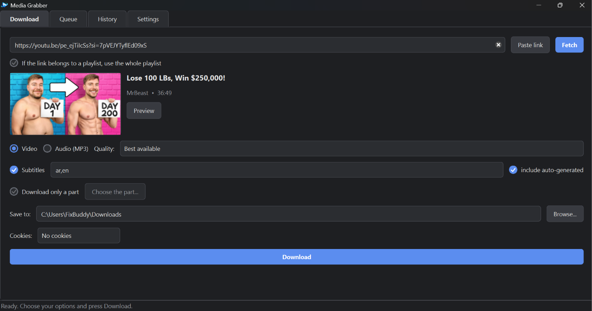
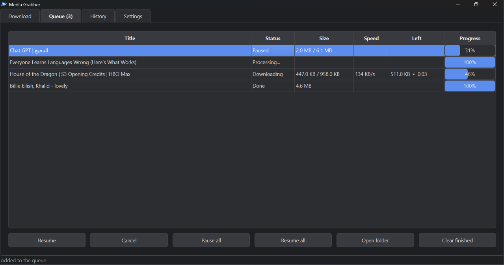
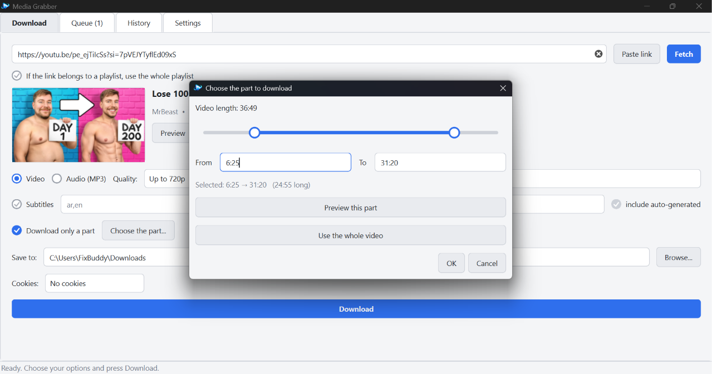
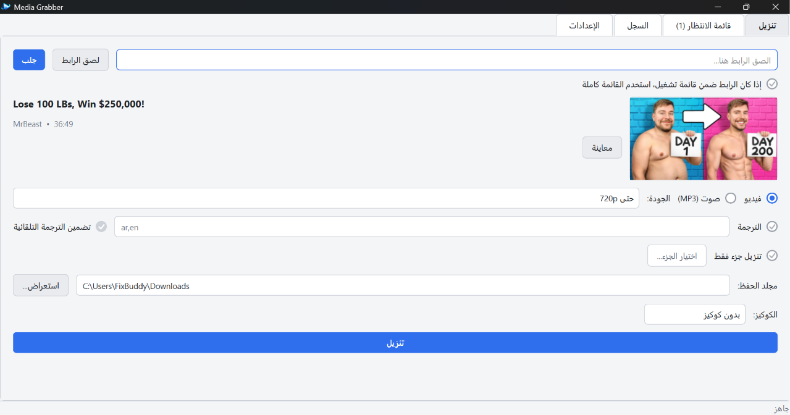
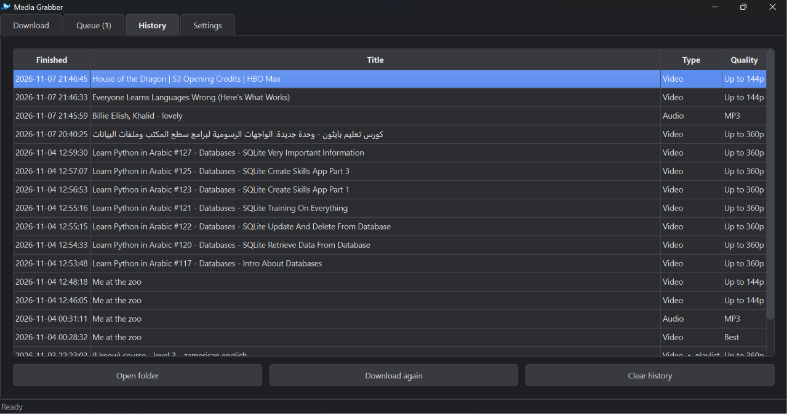
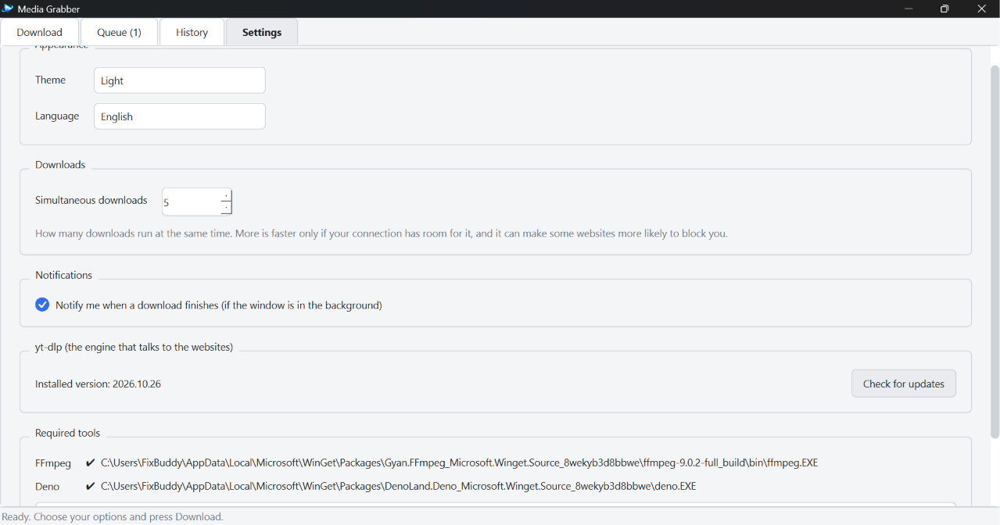

<p align="center">
  
</p>

<h1 align="center">Media Grabber</h1>

<p align="center">
  A clean desktop app for downloading video and audio, in English and Arabic.<br>
  Built with Python, PySide6 and yt-dlp.
</p>

<p align="center">
  <a href="https://github.com/abdohSH-web/media-grabber/releases/latest"><b>⬇ Download for Windows</b></a>
  &nbsp;·&nbsp;
  <a href="#features">Features</a>
  &nbsp;·&nbsp;
  <a href="#screenshots">Screenshots</a>
  &nbsp;·&nbsp;
  <a href="#build">Build</a>
</p>

<p align="center">
  
  
  
  
</p>

## Screenshots

<table>
  <tr>
    <td align="center"><br><sub>Download</sub></td>
    <td align="center"><br><sub>Queue</sub></td>
  </tr>
  <tr>
    <td align="center"><br><sub>Download only a part</sub></td>
    <td align="center"><br><sub>Arabic interface (right to left)</sub></td>
  </tr>
  <tr>
    <td align="center"><br><sub>History</sub></td>
    <td align="center"><br><sub>Settings</sub></td>
  </tr>
</table>

## Features

- **Preview before downloading:** see the title, uploader, duration and thumbnail, and even play a small version of the video.
- **Video or audio:** choose a quality cap, or extract MP3.
- **Playlists:** see every video and tick the ones you want. Each video becomes its own queue item, saved in a folder named after the playlist and numbered in order.
- **Download queue:** many downloads at once (1 to 5, chosen in Settings), each with its own progress bar, size, speed and time left.
- **Pause, resume and cancel** any item or all of them. A paused download continues from where it stopped.
- **Survives a restart:** unfinished downloads come back, paused, the next time the app opens.
- **Subtitles:** save subtitle files (.srt) in the languages you choose.
- **Download only a part:** pick the start and end with a two-handle slider, and preview exactly that part first.
- **History** with "Download again" and "Open folder".
- **Cookie support** (a `cookies.txt` file or Firefox) for when a site asks you to prove you are not a bot.
- **Arabic and English interface**, including right-to-left layout, switchable at any time.
- **Dark and light themes**, desktop notifications, and a built-in yt-dlp update check.
- **One-click tool setup:** if FFmpeg or Deno is missing, the app downloads them for you, with no administrator rights.

## Install

Download `MediaGrabber-Setup-x.y.z.exe` from the [Releases page](https://github.com/abdohSH-web/media-grabber/releases/latest) and run it. It installs for the current user only, so it does not ask for administrator rights, and it adds a Start menu entry and an entry in *Installed apps*. On the first run, press **Download tools** if the app reports that FFmpeg or Deno is missing.

The installer is not code-signed, so Windows SmartScreen may show a warning: choose *More info*, then *Run anyway*. The release notes list the file's SHA-256 so you can check it.

## Requirements (to run from source)

- Windows 10 or 11
- Python 3.10 or newer
- [FFmpeg](https://ffmpeg.org/) and [Deno](https://deno.com/) (yt-dlp needs Deno for full YouTube support). Either press **Download tools** in the app, or use `winget install Gyan.FFmpeg` and `winget install DenoLand.Deno`.

## Run from source

```
python -m venv .venv
.venv\Scripts\activate
pip install -r requirements.txt
python main.py
```

## Build

```
.\build.ps1              # dist\MediaGrabber\MediaGrabber.exe
.\build_installer.ps1    # installer_output\MediaGrabber-Setup-x.y.z.exe (needs Inno Setup 6)
```

Both scripts install the newest yt-dlp first, because websites change often and old versions stop working. To update a packaged app, build it again.

## Tests

```
pip install -r requirements-dev.txt
pytest
```

The queue is tested without any internet: a fake downloader stands in for the real one, so the tests check parallel limits, pause, resume, cancel and failures in a few seconds.

## Architecture

- `grabber/` is the engine and knows nothing about the interface:
  - `downloader.py`: a small wrapper around yt-dlp (fetch info, download, cancel, progress callbacks) and the translation of yt-dlp errors into our own error types.
  - `jobs.py`: the queue, with a pool of worker threads and a state machine (pending, downloading, paused, done, failed, cancelled).
  - `queue_store.py` and `history.py`: the unfinished queue and the history, saved safely as JSON.
  - `toolsetup.py` and `tools.py`: finding, downloading and unpacking FFmpeg and Deno.
  - `models.py`, `errors.py`, `naming.py`, `updates.py`: data classes, errors that carry a code, folder-name cleaning and the update check.
- `ui/` is the PySide6 interface: main window, dialogs, a custom range slider, the video preview, the theme and the translations.
- `main.py` starts the application.

### Design decisions

- **The engine and the interface are separate.** The queue reports changes through a callback, and a small bridge turns that into a Qt signal that is safe across threads.
- **Errors carry a code, not a sentence.** The engine raises, for example, `bot_check`; the interface looks up the translation in the user's language.
- **Pause is "stop and continue".** Pausing keeps the partial file; resuming asks yt-dlp to continue from it.
- **Safe storage.** Files are written to a temporary file and swapped in, so they are never half-written, and a damaged file is backed up instead of crashing the app.
- **Nothing is trusted from the network.** Downloaded tool archives are unpacked by file name only, so a malicious archive cannot write outside the tools folder.

## Troubleshooting

- *"Sign in to confirm you're not a bot":* choose a `cookies.txt` file (or Firefox) under **Cookies**. Chrome, Edge and Brave cookies are usually blocked on Windows.
- *A download that used to work fails:* **Settings → Check for updates**, then update yt-dlp.
- *The preview doesn't play:* some websites refuse direct streams. Use *Open in browser* in the preview window.
- The app's files are in `%APPDATA%\MediaGrabber\MediaGrabber` (history, queue, downloaded tools and `app.log`).

## Third-party software

Media Grabber is released under the [MIT License](LICENSE). It uses these open-source components, each under its own license:

- [yt-dlp](https://github.com/yt-dlp/yt-dlp) (The Unlicense)
- [PySide6 / Qt for Python](https://doc.qt.io/qtforpython-6/) (LGPLv3)
- [FFmpeg](https://ffmpeg.org/) (LGPL/GPL, depending on the build) and [Deno](https://deno.com/) (MIT). These are **not** included in this repository or the installer: the app downloads them from their official sources when you ask it to.

## Disclaimer

For personal use. Respect copyright law and the terms of the websites you download from.